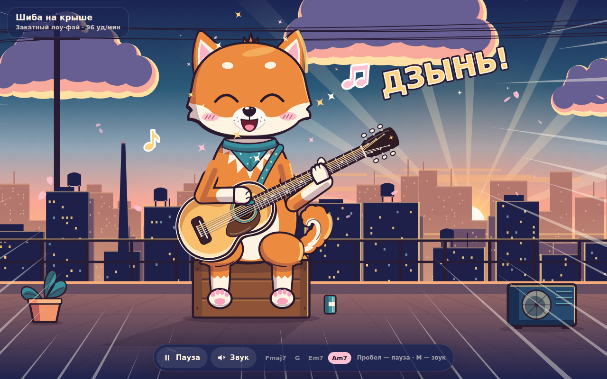

# Шиба на крыше

Аниме-анимация: рыжий шиба-ину сидит на ящике на крыше города на закате и играет на акустической гитаре.

## Как открыть

Откройте `index.html` в любом современном браузере. Всё лежит в одном файле: ни сборки, ни сервера, ни интернета не нужно.

## Управление

| Действие | Кнопка | Клавиша |
| --- | --- | --- |
| Пауза / продолжить | «Пауза» / «Играть» | Пробел |
| Включить / выключить звук | «Звук» | M |

Звук включается только после нажатия: браузеры не дают странице играть звук без действия пользователя.

## Что происходит в сцене

- **Персонаж.** Шиба нарисован в аниме-стиле: контурная линия разной толщины, cel-shading с жёсткой тенью и тёплым контровым светом от солнца, большие глянцевые глаза с бликами, румянец.
- **Гитара.** Нарисована анатомически верно: корпус с розеткой, подставкой и пикгардом, гриф с ладами и маркерами, голова с шестью колками, шесть струн. Правая лапа бьёт по струнам, левая зажимает аккорды на грифе.
- **Ритм.** Всё движение подчинено одним часам: 96 ударов в минуту, бой «вниз · вниз-вверх · вверх-вниз-вверх» с лёгким свингом. По тем же часам меняются аккорды Fmaj7 – G – Em7 – Am7, левая лапа переезжает по грифу, а струны вибрируют только на участке от подставки до зажатого лада.
- **Живость.** Голова качается в такт, уши, хохолок, хвост и бандана движутся с запаздыванием. Шиба дышит, моргает, иногда жмурится от удовольствия («^ ^»). От гитары разлетаются ноты.
- **Аниме-моменты.** Каждые 4 такта по очереди: прыжок с линиями фокуса и надписью «ДЗЫНЬ!»; блик по гитаре и глаза-звёздочки; порыв ветра с лепестками сакуры.
- **Фон.** Небо в духе Макото Синкая: облака с цветными краями, солнце с лучами, провода, птицы, три слоя города с мерцающими окнами, лепестки сакуры с параллаксом.
- **Звук.** Гитара синтезируется в браузере алгоритмом Карплуса — Стронга: те же аккорды, тот же бой, вниз от басовой струны и вверх от тонкой. Звук привязан к часам AudioContext и совпадает с движением лапы.

## Доступность и адаптивность

- Если в системе включено «Уменьшить движение» (`prefers-reduced-motion`), сцена открывается на паузе в красивой позе; анимацию можно запустить кнопкой.
- Когда вкладка скрыта, анимация и звук останавливаются, а потом продолжаются без рывка.
- На телефоне сцена перестраивается под вертикальный экран: гриф ставится круче, персонаж крупнее, ноты летят в свободную часть кадра.
- У кнопок есть подписи для экранных дикторов и видимый фокус с клавиатуры.

## Технически

Один файл `index.html`: SVG и чистый JavaScript, без библиотек, шрифтов из сети и картинок. Каждый кадр поза персонажа вычисляется как функция времени песни. Конечности ставятся двухзвенной инверсной кинематикой, чтобы лапы всегда оставались на гитаре.
